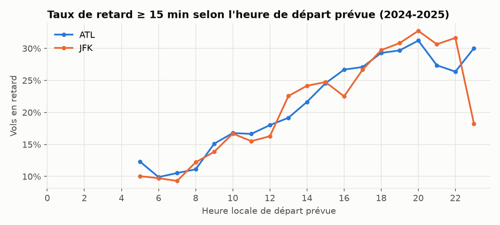
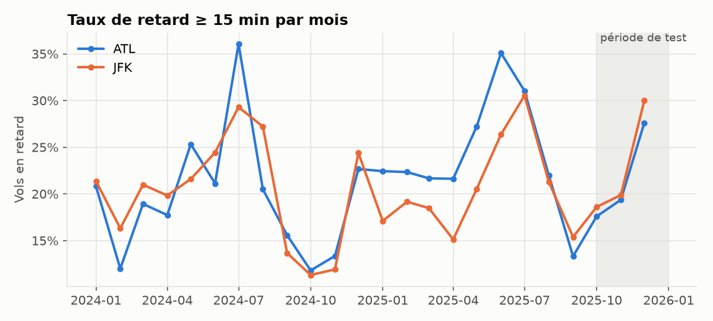
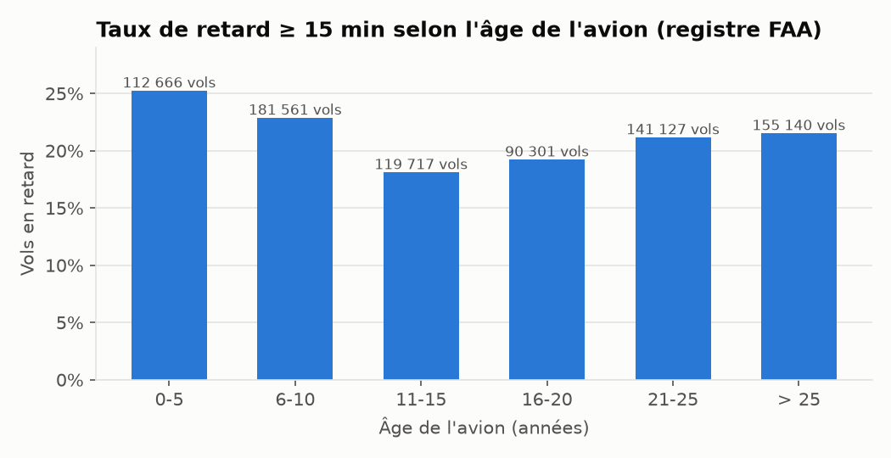
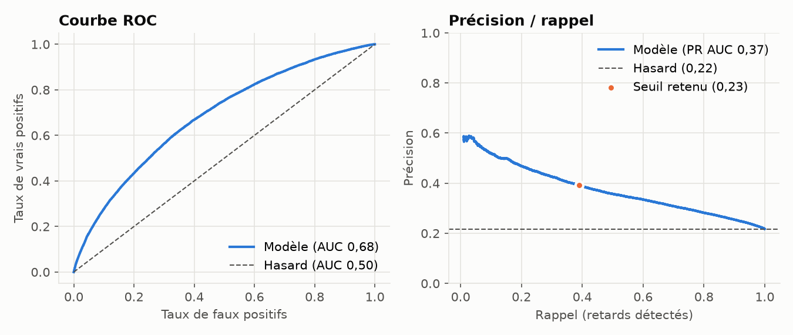
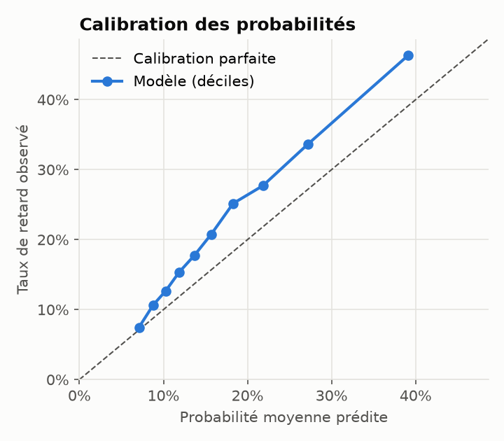
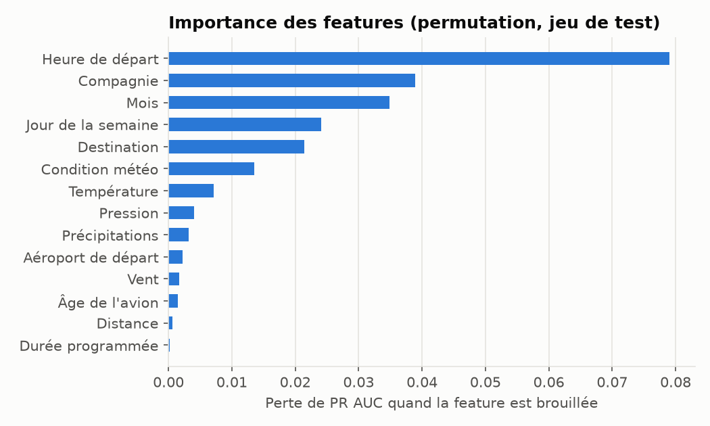
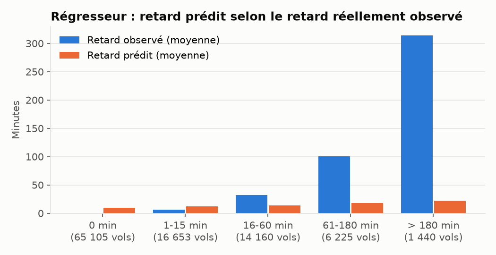

# Rapport de modélisation — prédiction du retard au départ

**DST Airlines · Étape 3 du cahier des charges (Livrable n°5)**

| | |
|---|---|
| Date | 21/10/2026 |
| Modèle évalué | `20261020225807` (MLflow : run `ddf5e31174744cc49517748fa0b7c5fc`, Model Registry version 3) |
| Données | 872 096 vols opérés au départ d'Atlanta (ATL) et de New York JFK, du 01/01/2024 au 31/12/2025, enrichis du registre des avions de la FAA |
| Code | [`src/ml/`](../src/ml/) · figures et chiffres régénérables par `python -m src.ml.evaluate` ([`figures/evaluation.json`](figures/evaluation.json)) |

---

## Résumé

- **Objectif** : estimer, avant le départ, la probabilité qu'un vol parte avec 15 minutes de retard ou plus (seuil officiel du DOT américain), et le nombre de minutes de retard attendu.
- **Données** : vols réels du BTS (Bureau of Transportation Statistics), joints à la météo horaire observée à l'aéroport de départ (Meteostat) et aux caractéristiques de l'avion (registre FAA), via l'entrepôt PostgreSQL du projet. 21,3 % des vols partent en retard.
- **Modèle retenu** : gradient boosting (`HistGradientBoostingClassifier` de scikit-learn), sélectionné contre une référence naïve et une régression logistique en validation croisée temporelle, hyperparamètres optimisés par recherche aléatoire.
- **Résultats sur 3 mois jamais vus** (oct.–déc. 2025, 103 583 vols) : ROC AUC **0,68** ; PR AUC **0,37** contre 0,22 au hasard ; parmi les 10 % de vols jugés les plus risqués, **46 %** partent réellement en retard, soit **2,1 fois** la moyenne. Le régresseur réduit l'erreur moyenne de 22,8 à **19,1 minutes** (−16 %).
- **Facteurs principaux** : l'heure de départ prévue, de loin, puis la compagnie, le mois, le jour de la semaine et la destination. La météo pèse peu en moyenne, car les épisodes sévères sont rares, mais fortement quand elle se dégrade.
- **Registre FAA** : 97,8 % des vols retrouvent leur avion. L'âge de l'avion n'apporte presque rien au modèle (+0,003 de PR AUC en validation croisée, nul sur le test) : à compagnie égale, les avions récents ne sont pas plus ponctuels. L'écart apparent entre flottes s'explique par la compagnie qui les exploite.
- **Limites** : les probabilités sont **sous-estimées** sur la période de test (17 % prédits en moyenne contre 22 % observés), à cause d'une dérive entre 2024 et 2025. Le régresseur ne sait pas anticiper les gros retards. Ces deux limites tiennent surtout à l'absence d'information sur la rotation des avions (retards en cascade), qui représente 30 % des minutes de retard. Des pistes concrètes figurent en section 10.

---

## 1. Problème et définition de la cible

Le cahier des charges demande « un algorithme de prédiction qui permettra de prédire le potentiel retard d'un vol ». Nous le traduisons en deux tâches complémentaires, calculées sur les mêmes features :

| Tâche | Cible | Usage |
|---|---|---|
| Classification | `dep_delay ≥ 15` min (1 = en retard) | Probabilité de retard et verdict « retard probable / à l'heure » |
| Régression | `max(dep_delay, 0)` en minutes | Ordre de grandeur du retard attendu |

**Choix du retard au départ plutôt qu'à l'arrivée** : le projet suit les départs depuis les aéroports pilotes, et la météo disponible est celle de l'aéroport de départ. Le retard à l'arrivée dépend en plus de facteurs en route et à destination que nous n'observons pas.

**Périmètre** : vols opérés uniquement. Les vols annulés (1,4 %) n'ont pas de retard défini et sont exclus ; prédire l'annulation serait une troisième tâche.

## 2. Données

### 2.1 Sources et jointures

Le jeu d'entraînement est produit par une seule requête SQL sur l'entrepôt en étoile ([`src/ml/dataset.py`](../src/ml/dataset.py)) :

| Table | Source | Apport |
|---|---|---|
| `fact_flights` | BTS On-Time Performance, 24 fichiers mensuels | Vol programmé (date, heure, route, compagnie, immatriculation de l'avion), retard observé |
| `dim_weather` | Meteostat, relevés horaires des stations des aéroports | Température, précipitations, vent, pression, code condition |
| `dim_aircraft` | Registre FAA (`MASTER.txt` + `ACFTREF.txt`), 5 261 avions | Âge, constructeur et modèle de l'avion |

La météo est jointe sur l'aéroport de départ et l'**heure programmée de départ convertie en UTC**, tronquée à l'heure. La conversion tient compte du fuseau de l'aéroport et des changements d'heure ; elle est vérifiée par des tests unitaires. L'avion est joint sur son immatriculation (`tail_num`), en ajoutant le préfixe « N » que le registre FAA omet.

### 2.2 Volume et répartition

| | ATL | JFK | Total |
|---|---|---|---|
| Vols opérés | 648 397 | 223 699 | 872 096 |
| Taux de retard ≥ 15 min | 21,6 % | 20,6 % | 21,3 % |

Le retard est très asymétrique : la moitié des vols partent à l'heure ou en avance (médiane 0 min), 90 % ont moins de 45 min de retard, mais 1 % dépassent 208 min. Le retard moyen est de 15,6 min.



Le retard s'accumule au fil de la journée : environ 10 % des vols du matin partent en retard, contre plus de 30 % en soirée. C'est le signe des **retards en cascade** : un avion en retard le matin retarde ses vols suivants.



Les pics d'été (orages, trafic) et de fin d'année sont nets, mais d'une année à l'autre les mêmes mois ne se ressemblent pas : octobre et novembre 2025 sont nettement plus en retard qu'en 2024. Cette dérive a une conséquence directe sur la calibration (section 7).

### 2.3 Qualité des données

| Point | Constat | Traitement |
|---|---|---|
| Météo manquante | 0,02 % à 0,1 % des vols selon la variable (trous de relevé des stations) | Valeurs manquantes gérées nativement par le gradient boosting |
| Avion introuvable dans le registre FAA | 2,2 % des vols (237 immatriculations sur 5 494) : avion radié, réimmatriculé ou immatriculation saisie de façon erronée | Valeur manquante, gérée nativement |
| Âge de l'avion inconnu | 8,2 % des vols : avion introuvable ou année de fabrication absente du registre | Valeur manquante, gérée nativement |
| Noms de constructeurs | Le registre écrit un même constructeur de plusieurs façons (« AIRBUS », « AIRBUS SAS », « AIRBUS S A S », « AIRBUS INDUSTRIE »…) | Regroupés par famille pour l'analyse (2.4) ; le constructeur n'est pas une feature |
| Doublons | Aucun : clé primaire sur (date, compagnie, numéro de vol, origine, destination), chargement idempotent vérifié | — |
| Cohérence du retard | Contrôle sur janvier 2024 : le retard recalculé depuis les horaires programmés et réels coïncide avec le `DepDelay` officiel du BTS pour 99,9 % des vols | — |

### 2.4 Les avions : apport du registre FAA

**Couverture.** Les vols mobilisent 5 494 avions distincts, dont 5 257 sont retrouvés dans le registre : **97,8 % des vols** sont rattachés à leur avion, et l'âge est connu pour **91,8 %** d'entre eux. L'âge médian de la flotte est de 14 ans.



**L'âge n'explique pas le retard.** La relation n'est pas monotone : les avions les plus récents (0-5 ans) sont les plus en retard (25,2 %), ceux de 11 à 15 ans les moins en retard (18,1 %).

**L'explication est la compagnie.** Les avions récents sont surreprésentés chez des compagnies structurellement plus en retard : JetBlue, Frontier et Spirit réalisent 42 % des vols d'avions de moins de 5 ans. À compagnie égale, l'effet de l'âge disparaît presque :

| Compagnie | Avions de 0-5 ans | 6-15 ans | Plus de 15 ans |
|---|---|---|---|
| Delta (DL) | 21,1 % | 19,8 % | 20,8 % |
| Southwest (WN) | 24,6 % | 24,3 % | 26,3 % |
| JetBlue (B6) | 29,1 % | 24,1 % | 28,9 % |
| American (AA) | 15,7 % | 16,6 % | 21,1 % |
| Frontier (F9) | 33,0 % | 37,9 % | — |

*Taux de vols partis avec 15 min de retard ou plus.*

Le même mécanisme explique les écarts entre constructeurs :

| Famille (registre FAA regroupé) | Vols | Taux de retard | Âge moyen |
|---|---|---|---|
| Boeing | 429 112 | 19,8 % | 19,9 ans |
| Airbus | 285 165 | 24,1 % | 11,8 ans |
| Bombardier | 64 532 | 17,3 % | 16,9 ans |
| Embraer | 42 830 | 16,5 % | 15,6 ans |
| Airbus Canada (A220) | 30 110 | 29,7 % | 3,2 ans |
| Avion non trouvé | 18 874 | 25,2 % | — |

Les Bombardier et Embraer sont des avions régionaux, exploités par des compagnies régionales sous-traitantes des grandes compagnies (Endeavor et SkyWest pour 91 % des vols en Bombardier, Republic pour 83 % des vols en Embraer), sur des lignes courtes globalement plus ponctuelles. Les Airbus A220, récents, volent à 82 % chez JetBlue. Ces écarts reflètent l'exploitant et le type de ligne, pas une moindre fiabilité de l'appareil.

**Conséquence pour le modèle** : comme la compagnie est déjà une feature, l'âge n'ajoute presque pas d'information (section 5.4). Il est conservé : son coût est nul et il peut aider sur des flottes ou des compagnies nouvelles.

## 3. Features

Toutes les features sont **connues avant le départ**. Les heures réelles, les temps de vol réels et les causes de retard renseignées par le BTS sont exclus : ils ne sont connus qu'après coup et provoqueraient une fuite de la cible.

| Feature | Type | Source | Justification |
|---|---|---|---|
| `origin` | catégorielle | vol | Deux aéroports aux profils de congestion différents |
| `dest` | catégorielle | vol | Certaines destinations sont plus congestionnées (contrôle aérien) |
| `op_carrier` | catégorielle | vol | Organisation des rotations et réserves propres à chaque compagnie |
| `dep_hour` | numérique | heure programmée | Accumulation des retards dans la journée |
| `day_of_week`, `month` | numériques | date | Saisonnalité du trafic et de la météo |
| `distance`, `crs_elapsed_time` | numériques | vol | Type de vol (court / long-courrier) |
| `aircraft_age` | numérique | FAA | Fiabilité technique supposée (apport faible, cf. 2.4) |
| `temp`, `prcp`, `wspd`, `pres` | numériques | météo | Conditions au départ |
| `coco` | catégorielle | météo | Code condition Meteostat (clair, pluie, neige, orage…) |

Les destinations et compagnies vues moins de 20 fois sont regroupées en une catégorie « rare ». Une destination ou une compagnie inconnue à l'inférence reste traitée sans erreur. Une feature entièrement vide sur la période d'entraînement (cas de l'âge de l'avion avant le chargement du registre FAA) est écartée automatiquement, et le fait est tracé dans MLflow.

Les features sont construites par **une seule fonction**, `build_features` ([`src/ml/model.py`](../src/ml/model.py)), partagée par l'entraînement, l'API et le dashboard : un écart entre les données vues à l'entraînement et celles reçues en production est impossible par construction.

## 4. Protocole d'évaluation

- **Découpage temporel** : entraînement du 01/01/2024 au 30/09/2025 (768 513 vols) ; test du 01/10/2025 au 31/12/2025 (103 583 vols). Le jeu de test n'est utilisé qu'une fois, à la toute fin. Un découpage aléatoire serait trop optimiste : des vols d'une même journée, qui partagent la même météo et les mêmes retards en cascade, se retrouveraient des deux côtés.
- **Validation croisée temporelle** (`TimeSeriesSplit`, 3 plis) sur un échantillon chronologique de 200 000 vols d'entraînement, pour comparer les modèles et régler les hyperparamètres : chaque pli est toujours évalué sur une période postérieure à celle d'entraînement.
- **Métrique de sélection : PR AUC** (précision moyenne). Avec seulement 21 % de vols en retard, la ROC AUC est flatteuse ; la PR AUC mesure directement la qualité de détection de la classe minoritaire. Sa valeur au hasard est égale au taux de retard (0,22).
- **Métriques rapportées** : ROC AUC, PR AUC, précision, rappel et F1 au seuil retenu, score de Brier, calibration ; pour le régresseur, MAE et RMSE comparées à une référence qui prédit toujours le retard moyen.

## 5. Sélection et optimisation du modèle

### 5.1 Comparaison des candidats (validation croisée temporelle)

| Candidat | PR AUC (CV) | Commentaire |
|---|---|---|
| Référence naïve (taux de retard constant) | 0,216 | Niveau du hasard |
| Régression logistique (one-hot + standardisation) | 0,342 | Effets additifs uniquement |
| **Gradient boosting** (hyperparamètres optimisés) | **0,362** | Retenu : capte les interactions (heure × compagnie, météo × aéroport…) |

Le gain du gradient boosting sur la régression logistique (+0,020) est réel mais modeste. L'essentiel de la performance vient des features, pas de la complexité du modèle : la marge de progrès est donc dans les données (section 10).

### 5.2 Hyperparamètres

Recherche aléatoire, 15 combinaisons × 3 plis pour le classifieur, 7 × 3 pour le régresseur :

| Paramètre | Espace exploré | Classifieur retenu | Régresseur retenu |
|---|---|---|---|
| `learning_rate` | log-uniforme 0,02 – 0,3 | 0,040 | 0,031 |
| `max_iter` | 150 – 600 | 151 | 237 |
| `max_leaf_nodes` | 15 – 128 | 20 | 114 |
| `min_samples_leaf` | 20 – 400 | 73 | 379 |
| `l2_regularization` | log-uniforme 0,001 – 10 | 4,34 | 0,004 |
| `max_features` | 0,5 – 1 | 0,83 | — |
| `loss` (régresseur) | Poisson, quadratique | — | Poisson |

Le classifieur retenu est volontairement simple (20 feuilles, forte régularisation) : la recherche privilégie un modèle qui généralise d'une période à l'autre plutôt qu'un modèle qui mémorise l'historique.

### 5.3 Seuil de décision et plafonnement

- **Seuil** : le modèle est réentraîné sur les 90 % les plus anciens de la période d'entraînement, et le seuil qui maximise le F1 est choisi sur les 10 % suivants : **0,23**. Le jeu de test n'intervient pas dans ce choix. Un seuil de 0,5 ne signalerait presque aucun vol, puisque les retards sont minoritaires.
- **Plafond du régresseur** : les minutes prédites sont bornées au 99ᵉ centile des retards d'entraînement (**208 min**). Lors des essais, la perte de Poisson extrapolait jusqu'à 331 min sur une combinaison rare (neige, −3 °C, vent fort, en soirée), alors que le retard moyen réellement observé sous la neige est de 62 min. Aucune prédiction du jeu de test n'atteint ce plafond avec le modèle actuel : c'est un garde-fou pour les cas extrêmes.

### 5.4 Avant / après le registre FAA

Même protocole, mêmes données de vols et même graine ; seule la disponibilité de l'âge de l'avion change :

| | Sans registre FAA (modèle `20261020223948`) | Avec registre FAA (modèle `20261020225807`) |
|---|---|---|
| PR AUC en validation croisée | 0,359 | 0,362 |
| ROC AUC (test) | 0,683 | 0,684 |
| PR AUC (test) | 0,374 | 0,375 |
| MAE du régresseur (test) | 19,0 min | 19,1 min |
| Importance de l'âge de l'avion | — | 0,001 (12ᵉ feature sur 14) |

Le gain est marginal en validation croisée et nul sur le test, ce qui confirme l'analyse de la section 2.4 : l'information portée par l'avion est déjà captée par la compagnie. Les écarts de seuil (0,22 puis 0,23) déplacent légèrement le compromis précision/rappel, sans changer la qualité du classement.

## 6. Résultats sur la période de test

### 6.1 Classifieur

| Métrique | Valeur | Repère |
|---|---|---|
| ROC AUC | **0,684** | 0,5 au hasard |
| PR AUC | **0,375** | 0,217 au hasard (taux de retard du test) |
| Précision au seuil 0,23 | 39,2 % | environ un vol signalé sur 2,5 part réellement en retard |
| Rappel au seuil 0,23 | 39,0 % | 39 % des retards sont anticipés |
| F1 | 0,391 | — |
| Taux de retard parmi les 10 % de vols les plus risqués | **46,3 %** | lift de **×2,13** |
| Score de Brier | 0,160 | 0,170 pour une prédiction constante égale au taux observé |



**Matrice de confusion au seuil retenu** (103 583 vols) :

| | Prédit « à l'heure » | Prédit « en retard » |
|---|---|---|
| **Réellement à l'heure** | 67 458 | 13 601 |
| **Réellement en retard** | 13 751 | 8 773 |

Le modèle signale 21,6 % des vols, une proportion proche du taux réel de retard. Le seuil est ajustable selon l'usage : un seuil plus haut donne des alertes plus sûres mais plus rares (jusqu'à 60 % de précision pour les vols les plus risqués, cf. courbe précision/rappel).

### 6.2 Stabilité par segment

| Segment | Vols | Taux de retard | ROC AUC | PR AUC |
|---|---|---|---|---|
| ATL | 77 903 | 21,4 % | 0,677 | 0,360 |
| JFK | 25 680 | 22,8 % | 0,705 | 0,417 |
| Octobre 2025 | 36 298 | 17,8 % | 0,678 | 0,322 |
| Novembre 2025 | 33 635 | 19,5 % | 0,674 | 0,341 |
| Décembre 2025 | 33 650 | 28,2 % | 0,662 | 0,425 |

La capacité de classement (ROC AUC) est stable d'un aéroport et d'un mois à l'autre, entre 0,66 et 0,71. Les écarts de PR AUC suivent surtout ceux du taux de retard.

## 7. Calibration



Le classement est bon, mais **les probabilités sont sous-estimées** : sur chaque décile, le taux de retard observé dépasse la probabilité prédite (46 % observés contre 39 % prédits pour le décile le plus risqué ; 17,4 % prédits en moyenne contre 21,7 % observés).

**Cause** : une dérive entre années. Le modèle a appris l'effet du mois sur un seul automne, celui de 2024, particulièrement calme (12 à 13 % de retards en octobre-novembre 2024), alors que l'automne 2025 a été bien plus perturbé (18 à 20 %). Le mois est la 3ᵉ feature la plus importante : elle transporte cette saisonnalité spécifique à 2024.

**Conséquences et remèdes** :
- le verdict « retard probable » reste pertinent, car le seuil a été choisi sur des données récentes ; seules les probabilités affichées sont prudentes ;
- réentraîner régulièrement sur une fenêtre glissante (le pipeline le permet en une commande) ;
- recalibrer les probabilités (régression isotonique) sur la période la plus récente ;
- remplacer le mois brut par des variables plus stables d'une année à l'autre (vacances, jours fériés, trafic programmé).

## 8. Interprétabilité



L'importance est mesurée **par permutation** sur le jeu de test : on brouille une feature et on mesure la perte de PR AUC. La mesure est indépendante du type de modèle et lisible par un non-spécialiste. Elle est exposée par l'API (`feature_importances`) et affichée dans le dashboard, conformément à l'exigence d'interprétabilité du MVP.

- **L'heure de départ prévue domine** (0,079, soit deux fois la suivante) : c'est l'empreinte des retards en cascade.
- **Compagnie, mois, jour de la semaine, destination** (0,02 à 0,04) : organisation propre aux compagnies, saisonnalité, congestion des aéroports d'arrivée.
- **Météo** (code condition, température, pression, précipitations, vent : 0,002 à 0,014) : faible en moyenne, car 99,5 % des vols partent sans neige ni orage. Son effet est pourtant net quand elle se dégrade : sous la neige, le retard moyen observé est de 62 min contre 15 min par temps ordinaire, et le simulateur du dashboard fait passer la probabilité de retard d'un départ en soirée de 66 % par temps clair à 74 % sous orage.
- **Âge de l'avion, aéroport, distance, durée** : quasi nuls une fois les autres variables connues (cf. 2.4 pour l'âge de l'avion).

## 9. Régresseur (minutes de retard)

| Métrique | Modèle | Référence (retard moyen constant) |
|---|---|---|
| MAE | **19,1 min** | 22,8 min |
| RMSE | 48,8 min | 49,6 min |
| Retard moyen prédit / observé | 11,2 / 15,9 min | — |
| Corrélation prédit / observé | 0,21 | — |



Le régresseur améliore l'erreur moyenne de 16 %, mais **il ne sait pas anticiper les gros retards** : pour les vols réellement retardés de plus de 3 h, il prédit 22 min en moyenne. Avec des features connues à l'avance, un retard de 3 h (panne, équipage, avion bloqué ailleurs) est imprévisible. Le modèle prédit donc une espérance prudente. Dans l'API et le dashboard, **les minutes attendues sont à présenter comme un ordre de grandeur** ; la probabilité de retard est l'information fiable.

## 10. Limites et pistes d'amélioration

**Ce que le modèle ne voit pas.** Les causes déclarées par les compagnies au BTS, pour les vols arrivés avec 15 min de retard ou plus, se répartissent ainsi (minutes de retard) :

| Cause | Part | Visible par le modèle ? |
|---|---|---|
| Compagnie (maintenance, équipage, préparation) | 41,8 % | Indirectement (compagnie, heure ; âge de l'avion sans effet propre) |
| Avion précédent arrivé en retard | 29,8 % | **Non** |
| Contrôle aérien / congestion (inclut la météo non extrême) | 22,7 % | Partiellement (destination, météo au départ) |
| Météo extrême | 5,5 % | Oui (météo au départ) |
| Sûreté | 0,2 % | Non |

**Pistes, par gain attendu :**

1. **Retards en cascade** (30 % des minutes) : retard de l'avion sur ses vols précédents de la journée, retrouvé via `tail_num` dans `fact_flights`. En temps réel, l'heure d'arrivée estimée de l'avion entrant (OpenSky ou une API d'horaires). Le rattachement des vols à leur avion, désormais validé à 97,8 % par le registre FAA, rend cette piste directement exploitable.
2. **Congestion programmée** : nombre de départs et d'arrivées prévus dans l'heure à l'aéroport, calculable à l'avance depuis les horaires.
3. **Météo à destination** et prévisions plutôt qu'observations, pour coller aux conditions d'usage réelles.
4. **Recalibration et réentraînement glissant** (section 7).
5. **Rotation de l'avion dans la journée** (combientième vol de la journée pour cet avion, temps de rotation prévu au sol) : plus informatif que son âge.
6. Pour le régresseur : modéliser les gros retards séparément (modèle en deux temps, ou prédiction d'intervalles par régression quantile).

**Biais et usage responsable** : le modèle reflète les pratiques passées des compagnies. Une compagnie historiquement plus en retard est pénalisée a priori, ce qui est utile pour l'usager mais ne doit pas être présenté comme un jugement de qualité. Il en va de même pour les écarts entre constructeurs (section 2.4), qui reflètent l'exploitant et non l'appareil. Le périmètre est limité à deux grands aéroports américains : le modèle ne doit pas être utilisé ailleurs sans réentraînement.

## 11. Industrialisation et reproductibilité

| Élément | Mise en œuvre |
|---|---|
| Versionning | MLflow : un run par entraînement (paramètres, features utilisées et écartées, métriques, importances, période), un run enfant par candidat ; classifieur et régresseur inscrits au Model Registry (`dst-airlines-delay-classifier`, `dst-airlines-delay-regressor`, version 3 = modèle avec registre FAA) |
| Service | API FastAPI `/predict` (vérifiée sur 100 vols par `src/ml/score.py`, cf. [résultats de scoring](resultats_scoring.md)) : probabilité, verdict au seuil retenu, minutes attendues, facteurs principaux ; dashboard Dash (onglet Prédiction) |
| Reproductibilité | Graine fixée, version de scikit-learn figée (`1.9.1`) car les modèles sérialisés exigent la même version à l'entraînement et en service ; découpage et données déterministes |
| Tests | `tests/test_model.py` : features, cibles, découpage temporel, seuil, plafonnement, feature vide écartée, rejet des modèles d'un format antérieur, entraînement complet qui doit battre la référence naïve ; `tests/test_evaluate.py` : figures et chiffres de ce rapport ; test d'intégration PostgreSQL du jeu d'entraînement |
| Coût | Entraînement complet : ~2 min et ~1,8 Go de RAM sur un poste de développement |

**Reproduire ce rapport :**

```bash
just warehouse                 # données 2024-2025 (extract → transform → load)
# Registre FAA : ReleasableAircraft.zip téléchargé depuis un navigateur dans data/raw/faa/, puis :
python -m src.etl.dimensions aircraft && python -m src.etl.warehouse aircraft
python -m src.ml.train         # entraînement + MLflow (~2 min)
python -m src.ml.evaluate      # figures et chiffres de docs/figures/
mlflow ui --backend-store-uri sqlite:///mlflow.db --port 5000
```

Contrôle du modèle tel qu'il est servi par l'API, sur 100 vols de la période de test : [résultats de scoring](resultats_scoring.md) (`python -m src.ml.score --docs`).
